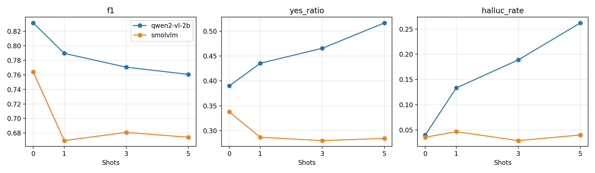

# When Examples Mislead: Few-Shot Prompting and Object Hallucination in Small VLMs

**Research question:** if we show a small vision-language model a few solved examples before asking *"Is there a dog in the image?"*, does it hallucinate objects less?

**Short answer: no.** On the POPE benchmark, in-context examples made both models worse, and they failed in opposite directions. Qwen2-VL-2B started saying "yes" to objects that are not there, while SmolVLM became over-cautious and started missing objects that are there.

## Key results

900 balanced POPE questions per model (300 per split, half "yes" and half "no"), each asked at 0, 1, 3 and 5 shots: **3,600 scored questions per model**.

### Average over the three splits

| Model | Shots | Accuracy | F1 | Precision | Recall | "Yes" ratio | Hallucination rate ↓ | AUROC | Prompt tokens |
|---|:-:|:-:|:-:|:-:|:-:|:-:|:-:|:-:|:-:|
| Qwen2-VL-2B | 0 | **0.850** | **0.832** | 0.949 | 0.740 | 0.390 | **4.0%** | **0.946** | 229 |
| Qwen2-VL-2B | 1 | 0.802 | 0.790 | 0.852 | 0.738 | 0.436 | 13.3% | 0.889 | 451 |
| Qwen2-VL-2B | 3 | 0.777 | 0.771 | 0.806 | 0.742 | 0.466 | 18.9% | 0.867 | 895 |
| Qwen2-VL-2B | 5 | 0.754 | 0.761 | 0.756 | 0.771 | 0.517 | **26.2%** | 0.842 | 1,338 |
| SmolVLM | 0 | **0.802** | **0.764** | 0.949 | **0.640** | 0.338 | 3.6% | **0.917** | 116 |
| SmolVLM | 1 | 0.740 | 0.670 | 0.919 | 0.527 | 0.287 | 4.7% | 0.896 | 234 |
| SmolVLM | 3 | 0.751 | 0.681 | 0.949 | 0.531 | 0.280 | 2.9% | 0.910 | 471 |
| SmolVLM | 5 | 0.744 | 0.674 | 0.930 | 0.529 | 0.284 | 4.0% | 0.903 | 707 |

*Hallucination rate = false positive rate: how often the model says "yes" when the object is not in the image.*

### Qwen2-VL-2B by split

| Split | F1 (0-shot → 5-shot) | Hallucination rate (0-shot → 5-shot) | McNemar p, 5-shot vs 0-shot |
|---|:-:|:-:|:-:|
| Random | 0.844 → 0.819 | 1.3% → 10.7% | 0.174 (n.s.) |
| Popular | 0.831 → 0.726 | 4.0% → 34.7% | < 0.001 |
| Adversarial | 0.819 → 0.738 | 6.7% → 33.3% | < 0.001 |

For SmolVLM, the drop in accuracy is significant (p < 0.05) on all three splits at 1-shot and 5-shot.

## Findings

1. **Examples hurt instead of help.** Qwen2-VL-2B's F1 falls from 0.832 to 0.761 and its **hallucination rate rises from 4.0% to 26.2%** at 5-shot. SmolVLM's F1 falls from 0.764 to 0.674.
2. **The harm grows with harder questions.** On the *random* split (absent objects picked at random) Qwen barely changes. On *popular* and *adversarial* splits, where the absent object is common or often appears together with what is in the image, the hallucination rate jumps to about 34%.
3. **The two models fail in opposite ways.** Qwen's "yes" ratio climbs from 0.39 to 0.52 (more false "yes"). SmolVLM's drops from 0.34 to 0.28 and its recall falls from 0.64 to 0.53 (more false "no").
4. **It is not only a bias shift.** For Qwen, AUROC also drops from 0.946 to 0.842, so the examples reduce how well the model separates present from absent objects, not just where it draws the yes/no line.
5. **Examples are expensive.** At 5-shot the prompt is about **6 times longer** for both models.

**Takeaway:** for these small VLMs, extra example images in the prompt seem to act as distractors rather than guidance. Reducing hallucination likely needs methods that improve visual grounding itself, not more examples in the prompt.

## Method

- **Models:** [Qwen/Qwen2-VL-2B-Instruct](https://huggingface.co/Qwen/Qwen2-VL-2B-Instruct) and [HuggingFaceTB/SmolVLM-Instruct](https://huggingface.co/HuggingFaceTB/SmolVLM-Instruct), loaded in **4-bit NF4** with bitsandbytes (double quantization). The vision encoder and output head are kept in 16-bit for quality.
- **Benchmark:** [POPE](https://huggingface.co/datasets/lmms-lab/POPE) on COCO, three splits: random, popular, adversarial.
- **Balanced evaluation set:** 150 "yes" and 150 "no" questions per split, sampled with a fixed seed and frozen to disk.
- **No leakage:** 10 COCO images are reserved only for in-context examples, and the code checks that none of them appears in the test set. Examples are balanced yes/no and taken from the same split.
- **Scoring:** instead of free text generation, the model's next-token probability of *Yes* vs *No* is read in a single forward pass. Prediction = Yes if P(yes) ≥ 0.5. This is fast, deterministic, and gives a confidence score for AUROC.
- **Statistics:** accuracy, precision, recall, F1, "yes" ratio, hallucination rate, AUROC, **bootstrap 95% CIs** for F1, and an **exact McNemar test** comparing each k-shot run with 0-shot on the same questions.

## How to run

Runs on a **single free T4 GPU** (Colab or Kaggle).

1. Open `VLM_FewShot_POPE_Hallucination.ipynb` and choose a GPU runtime.
2. Set `MODEL_NAME = "qwen2-vl-2b"` (or `"smolvlm"`) in the configuration cell and run all cells.
3. Every answer is appended to `results_<model>.jsonl` on Google Drive (`MyDrive/VLM_FewShot_POPE/`). If the session stops, run all cells again and finished questions are skipped.
4. Run once per model. The last section then plots both models side by side.

The notebook writes metric tables, McNemar results, figures and a short `report.md` for each model.

Settings you can change: number of shots, questions per split (up to about 2,940), image size (`MAX_IMAGE_SIDE = 448`) and the number of reserved demo images.

## Main libraries

PyTorch · Hugging Face Transformers · bitsandbytes · Accelerate · Datasets · scikit-learn · SciPy · pandas · matplotlib

## Limitations

- A subset of POPE (300 questions per split), one demo-sampling seed and one prompt template.
- 4-bit weights; full-precision models may behave differently.
- Two small models only. Larger VLMs may use in-context examples better, so the result may not transfer to them.

## Author

**Sadaf Zehra**, MS Data Science, NED University of Engineering and Technology
[GitHub](https://github.com/SadafZehra) · [LinkedIn](https://www.linkedin.com/in/sadaf-zehra-796858230) · [ORCID](https://orcid.org/0009-0009-7530-9006)
