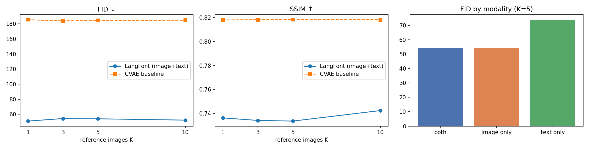

# LangFont: Language-Guided Few-Shot Font Generation with Diffusion

Give the model a few letters of a font it has never seen, plus a short description like *"bold, rounded, handwritten"*, and it draws the missing characters in that style.

LangFont fine-tunes **Stable Diffusion 1.5 with LoRA** and adds a small **StyleEncoder** that turns 1 to 10 reference glyphs into extra cross-attention tokens. The UNet sees the text prompt and the reference images together. This project follows up on my MS thesis, which used a conditional VAE (CVAE) for few-shot font generation, and asks whether a pretrained diffusion model with language guidance does better.



*Left: FID vs number of reference images K (lower is better). LangFont stays between 51 and 54 for every K, while the CVAE baseline stays near 185. Middle: SSIM vs K (higher is better); the CVAE keeps a higher SSIM at about 0.818, LangFont is between 0.734 and 0.742. Right: FID by input at K = 5; images + text and images only both reach about 54, text only is clearly worse at 73.7.*

## Key results

Test set: **38 fonts from 30 font families that were never seen in training**, 10 target characters per font (380 images per method). All images are compared at 128 px.

| Method | Input | K refs | FID ↓ | KID×1000 ↓ | SSIM ↑ | CLIP-T ↑ | CLIP-I ↑ |
|---|---|:-:|:-:|:-:|:-:|:-:|:-:|
| CVAE baseline (thesis-style) | images | 5 | 184.62 | 94.27 | **0.818** | 26.19 | 0.776 |
| LangFont | text only | 5 | 73.75 | 15.76 | 0.645 | 28.56 | 0.844 |
| LangFont | images only | 5 | 54.07 | **7.65** | 0.746 | **28.97** | 0.879 |
| LangFont | images + text | 5 | 54.07 | 7.80 | 0.734 | 28.81 | 0.877 |
| LangFont | images + text | 1 | **51.05** | 8.56 | 0.736 | 28.75 | 0.871 |
| LangFont | images + text | 10 | 52.32 | 7.98 | 0.742 | 28.66 | **0.880** |

**What the numbers say**

- **LangFont cuts FID from 184.6 to 54.1 against the CVAE baseline** (KID×1000 from 94.3 to 7.8) and generates glyphs that are closer to the real ones in CLIP space (0.877 vs 0.776).
- **The CVAE still has the higher SSIM** (0.818 vs 0.734). SSIM rewards smooth, average-looking shapes, while FID and CLIP-I reward realistic, sharp glyphs. I report both on purpose.
- **Reference images carry most of the style.** Text alone gives FID 73.7; adding images brings it to 54.1. Adding text on top of images gives no clear extra gain in this setup.
- **Quality is stable from 1 to 10 references** (FID 51 to 54), so even a single example letter is enough for the model to pick up the style.
- Sanity check: the Stable Diffusion VAE reconstructs Omniglot characters with SSIM 0.994, so the latent space is not the bottleneck for thin, binary glyphs.

## Method

```
reference glyphs (K = 1..10) ──► CLIP image embeddings ──► MLP ──► 4 tokens / ref ─┐
                             └─► small CNN (64 px)      ──────────► 4 tokens / ref ─┤
                                                                                    ├─► [77 text tokens + 8K style tokens] ─► SD 1.5 UNet + LoRA ─► glyph
text prompt "a black glyph of ... , bold, rounded, handwritten font" ──► CLIP text encoder (frozen) ──┘
```

- **Backbone:** Stable Diffusion 1.5, frozen. Only LoRA adapters (rank 8, on the attention projections, 1.59M parameters) and the StyleEncoder (16.23M parameters) are trained.
- **Modality dropout:** during training, 10% of samples drop everything (for classifier-free guidance), 15% drop the reference images and 15% drop the style words. One model therefore runs in three modes: images only, text only, or both.
- **Training:** 4,000 steps, cosine learning rate (1e-4), Min-SNR loss weighting, fp16, gradient checkpointing, 8-bit AdamW. K is sampled from {1, 3, 5, 10} during training.
- **Sampling:** DPM-Solver, 25 steps, guidance scale 5.0, same noise seed for every method.
- **Baseline:** a few-shot CVAE in the style of my thesis model (style = mean of the K reference encodings, 128-d latent, KL annealing), trained for 6,000 steps on the same data.

## Data

- **300 Google Fonts** (at most 2 styles per family), each rendered as all **62 characters** (A–Z, a–z, 0–9). Fonts missing any character are filtered out.
- Fonts are split **by family**, so no family appears in both train (262 fonts) and test (38 fonts).
- **Text descriptions are created automatically.** OpenCV measures stroke width (2 × area / perimeter), slant (image moments of vertical stems), corner sharpness (corner density along the outline) and width (aspect ratio). Each measure is compared with dataset percentiles and turned into words such as *thin / light / bold / heavy*, *italic*, *rounded / sharp angular* and *condensed / wide*, then combined with the Google Fonts category (serif, sans-serif, handwritten, decorative display, monospace).
- Only the needed font files are downloaded from the [google/fonts](https://github.com/google/fonts) repository using a sparse git checkout.

## Evaluation metrics

| Metric | What it measures |
|---|---|
| **FID** | Distance between real and generated image distributions (Inception features) |
| **KID** | Same idea as FID but unbiased, more reliable for small test sets |
| **SSIM** | Pixel-level structural similarity to the true glyph |
| **CLIP-T** | How well the generated glyph matches the text description |
| **CLIP-I** | Cosine similarity between generated and real glyph in CLIP image space |

## How to run

The notebook is built for a **free Google Colab T4 GPU** and survives disconnects.

1. Open `LangFont_FewShot_Font_Generation.ipynb` in Google Colab and select a GPU runtime.
2. Run all cells. The notebook mounts Google Drive and saves checkpoints, the data cache, generations and results in `MyDrive/LangFont/`.
3. If the session stops, run all cells again. Training resumes from the last checkpoint (saved every 200 steps or every 10 minutes), and finished generations are skipped.
4. Set `FAST_DEV_RUN = True` for a quick end-to-end test with a tiny budget.

The notebook adapts batch size and resolution to the GPU it finds (256 px on a T4, 512 px on cards with 20 GB or more).

**Try your own font:** put 1 to 10 images of single letters in `MyDrive/LangFont/my_refs/` and run the demo cell. It generates the word `LangFont2026` in your style under different text prompts.

## Main libraries

PyTorch · Hugging Face Diffusers · Transformers · PEFT (LoRA) · bitsandbytes · torchmetrics · scikit-image · OpenCV · fontTools

## Limitations and next steps

- One training run and one seed; differences of a few FID points between settings should be treated as noise until repeated.
- 4,000 training steps on a T4 at 256 px. A longer run at 512 px would likely improve fine stroke detail.
- Automatic descriptions use a small vocabulary. Richer, human-written or LLM-written descriptions may let text contribute more on top of images.
- Latin characters only. Extending to scripts with complex shapes, such as Arabic or Urdu, is the natural next step.

## Author

**Sadaf Zehra**, MS Data Science, NED University of Engineering and Technology
[GitHub](https://github.com/SadafZehra) · [LinkedIn](https://www.linkedin.com/in/sadaf-zehra-796858230) · [ORCID](https://orcid.org/0009-0009-7530-9006)
